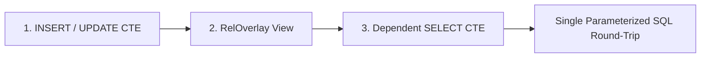

# Query Pipelines & CTE Statement Stacking

Network round-trips dominate handler latency when code issues sequential reads and writes. `QueryPipeline`, `CteStep`, and `RelOverlay` (`vertebra.db.pipeline`) compile multi-step mutations and dependent queries into a single parameterized PostgreSQL CTE statement executed in one round-trip.



## Composing a `QueryPipeline`

Stack multiple read and write steps into one statement with intra-statement read-your-own-writes over uncommitted CTE inserts and deletes:

```python
from vertebra.db import QueryPipeline, RelOverlay

pipeline = (
    QueryPipeline()
    .add_step(
        "inserted_order",
        "INSERT INTO orders (id, customer_id, total_cents) "
        "VALUES (:id, :customer_id, :total) RETURNING *",
        params={"id": 501, "customer_id": 9, "total": 4500},
    )
    .add_overlay(
        "orders_with_new",
        RelOverlay(
            base_table="orders",
            inserted_cte="inserted_order",
            id_column="id",
        ),
    )
    .add_step(
        "customer_orders",
        "SELECT id, total_cents FROM orders_with_new "
        "WHERE customer_id = :customer_id",
        params={"customer_id": 9},
    )
)

sql, params = pipeline.compile()
```

## Key Primitives

- **`RelOverlay`**: Generates a `UNION ALL` / `NOT IN` CTE view over a physical `base_table` and earlier `INSERT ... RETURNING *` or `DELETE ... RETURNING id` steps so subsequent CTE steps in the same statement observe uncommitted mutations immediately.
- **`QueryPipeline.build_jsonb_object`**: Automatically chunks wide column projections into concatenated `jsonb_build_object(...) || jsonb_build_object(...)` expressions so queries never trip PostgreSQL's 100-argument function limit (`max_pairs_per_call=50`).
- **SQLSpec Statement Stacking**: When using [`SQLSpecPlugin`](extensions.md) (`vertebra.extensions.sqlspec`), SQLSpec `StatementStack` pipelines and `execute_many` batches run over shared-memory leases and cached prepared statement plans (`StatementCache`).
- **Pooler-Safe Statement Caching (`PostgresConfig`)**: Behind transaction-mode poolers (`PgBouncer`, `PgCat`, `pgdog`), `PostgresConfig.effective_statement_cache_size` disables connection-pinned prepared statements unless `protocol_level_pooler_cache=True` is set.
