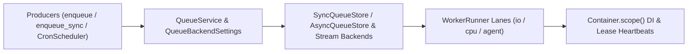

# Queues, LiveState, Email & Telemetry

`vertebra.framework` includes distributed background task queues (`QueueService`, `QueueBackendSettings`, `CronScheduler`), WebSocket delta state synchronization and cross-node pub/sub (`LiveState`, `ChannelsBackend`, `ChannelBus`), RESP3 key-value stores (`ValkeyStore`, `RedisStore`, `MemoryStore`, `KeyValueStore`), transactional email (`EmailService`), and OpenTelemetry instrumentation (`vertebra.telemetry`).

## Background Task Queues, Backends & Cron (`vertebra.framework.queues`)

`QueueService` provides background task execution, per-attempt scoped DI (`Container.scope()`), lease heartbeats, retry policies (`TaskRetryPolicy` with exponential backoff and dead-letter queues), delayed scheduling (`enqueue_delayed`), synchronous producer enqueueing (`enqueue_sync`), and cron jobs (`CronScheduler` with slot-keyed distributed leader leases):



| Backend | Scheme / Class | Backing Mechanism | Requires |
| --- | --- | --- | --- |
| **Memory** | `memory://` (`MemoryQueueBackend`) | In-process queue for local dev and unit tests | Nothing |
| **PostgreSQL** | `postgresql://`, `postgres://` (`PostgreSQLQueueBackend`) | `SyncPostgresQueueStore` / `AsyncPostgresQueueStore` (`FOR UPDATE OF q SKIP LOCKED` + `LISTEN/NOTIFY` wakeups) | `vertebra-core[postgres]` (or custom `store=` / `executor=`) |
| **Oracle** | `oracle://` (`OracleQueueBackend`) | `SyncOracleQueueStore` / `AsyncOracleQueueStore` (`FOR UPDATE SKIP LOCKED` + TxEventQ / `DBMS_AQ` wakeups) | `vertebra-core[oracle]` (or custom `store=` / `executor=`) |
| **Redis** | `redis://`, `rediss://`, `unix://` (`RedisQueueBackend`) | Redis Streams consumer groups (`XREADGROUP` / `XACK`) + sorted-set delayed scheduling + Pub/Sub wakeups | `vertebra-core[redis]`, or `client=` (`RedisStreamClient`) |
| **Valkey** | `valkey://`, `valkeys://`, `unix://` (`ValkeyQueueBackend`) | Valkey Streams consumer groups (`XREADGROUP` / `XACK`) + sorted-set delayed scheduling + Pub/Sub wakeups | `vertebra-core[valkey]`, or `client=` (`ValkeyStreamClient`) |
| **Spanner** | `spanner://`, `spangres://` (`SpannerQueueBackend`) | `SyncSpannerQueueStore` / `AsyncSpannerQueueStore` (hash-sharded keys + interactive `ReadWrite` `FOR UPDATE` claims + dead-letter table) | `vertebra-core[spanner]` (or custom `store=` / `executor=`) |

`PostgreSQLQueueBackend`, `OracleQueueBackend`, and `SpannerQueueBackend` automatically construct `SyncPostgresQueueStore` / `AsyncPostgresQueueStore`, `SyncOracleQueueStore` / `AsyncOracleQueueStore`, and `SyncSpannerQueueStore` / `AsyncSpannerQueueStore` from configured drivers or DSNs (`QueueBackendSettings`), raising `MissingDependencyError` when `vertebra-core[postgres]`, `vertebra-core[oracle]`, or `vertebra-core[spanner]` is not installed. `RedisQueueBackend` and `ValkeyQueueBackend` run directly on `vertebra-core[redis]` and `vertebra-core[valkey]` across both async (`enqueue`) and sync (`enqueue_sync`) producers.

!!! note "Spanner Wakeup & TTL Compaction Notes"
    Spanner has no low-latency `LISTEN/NOTIFY` push channel, so `SpannerQueueBackend` wakes idle workers via bounded adaptive polling (`poll_interval_seconds`, shortened automatically by `next_due_delay` when delayed jobs are pending). `ROW DELETION POLICY` (GoogleSQL) and `TTL INTERVAL` (Spangres) reclaim expired rows asynchronously via background Spanner storage compaction rather than synchronously at expiration time; `cleanup_on_ack=True` deletes acknowledged rows immediately.

Install the optional wheel for your selected queue backend:

=== "uv"

    ```bash
    uv add "vertebra-core[postgres]"
    uv add "vertebra-core[oracle]"
    uv add "vertebra-core[redis]"
    uv add "vertebra-core[valkey]"
    uv add "vertebra-core[spanner]"
    ```

=== "pip"

    ```bash
    pip install "vertebra-core[postgres]"
    pip install "vertebra-core[oracle]"
    pip install "vertebra-core[redis]"
    pip install "vertebra-core[valkey]"
    pip install "vertebra-core[spanner]"
    ```

=== "pdm"

    ```bash
    pdm add "vertebra-core[postgres]"
    pdm add "vertebra-core[oracle]"
    pdm add "vertebra-core[redis]"
    pdm add "vertebra-core[valkey]"
    pdm add "vertebra-core[spanner]"
    ```

=== "poetry"

    ```bash
    poetry add "vertebra-core[postgres]"
    poetry add "vertebra-core[oracle]"
    poetry add "vertebra-core[redis]"
    poetry add "vertebra-core[valkey]"
    poetry add "vertebra-core[spanner]"
    ```

```python
from vertebra.framework.queues import (
    CronSchedule,
    CronScheduler,
    QueueBackendSettings,
    QueueService,
    TaskRetryPolicy,
    task,
)

queue = QueueService(QueueBackendSettings(kind="memory", backend_url="memory://"))


@task(
    name="emails.welcome",
    lane="io",
    retry_policy=TaskRetryPolicy(max_retries=3),
    cron=CronSchedule(expression="0 * * * *"),
)
async def send_welcome_email(user_id: int = 0) -> str:
    return f"sent:{user_id}"


queue.register(send_welcome_email)
scheduler = CronScheduler(queue)
```

Run background workers standalone (`vtb workers run app:app`) or co-located with HTTP workers (`vtb run app:app --with-workers --queues default,io`).

## Real-Time `LiveState` & Distributed Pub/Sub Channels

Synchronize server state with browser clients over WebSocket binary delta frames using `LiveState` and `@live_action` (`vertebra.framework.live`), or broadcast topic events across nodes with `ChannelsBackend` (`create_channels_backend`) and `ChannelBus` (`vertebra.framework.channels`) backed by `SyncNotificationSource` and `AsyncNotificationSource` across Memory, Valkey, Redis, PostgreSQL, and Oracle:

```python
from vertebra.framework.channels import create_channels_backend
from vertebra.framework.live import LiveState, LiveStateRoom, live_action


class CounterState(LiveState):
    count: int = 0

    @live_action
    def increment(self, step: int = 1) -> None:
        self.count += step


room = LiveStateRoom("room:lobby", CounterState())
bus = create_channels_backend(backend="valkey", url="valkey://localhost:6379/0")
```

## Key-Value Stores (`ValkeyStore`, `RedisStore`, `KeyValueStore`) & Transactional Email

Store cached responses or key-value state in `ValkeyStore` (`vertebra._valkey`), `RedisStore` (`vertebra._redis`), `MemoryStore`, or `KeyValueStore` (`NamespacedStore`), and send transactional emails through `EmailService` across 6 transports (`MemoryEmailTransport`, `SmtpEmailTransport`, `ResendEmailTransport`, `SendGridEmailTransport`, `MailgunEmailTransport`, `SesEmailTransport`):

`ValkeyStore` and `RedisStore` enable RESP3 `CLIENT TRACKING` local L1 invalidation by default, prefix every key with `key_prefix` (default `"vertebra"`), and remove only keys under that prefix via `SCAN` + `UNLINK` during `delete_all()`. Expiries are sent in milliseconds, and `expires_in()` returns `None` for keys without an expiry.

```python
from vertebra.framework.email import EmailConfig, EmailMessage, EmailService
from vertebra.framework.stores import KeyValueStore, ValkeyStore

cache = KeyValueStore(key_prefix="app-cache")
valkey_cache = ValkeyStore.from_url(
    "valkey://localhost:6379/0",
    key_prefix="app-cache",
)
email_service = EmailService(
    EmailConfig(backend="memory", default_from="noreply@example.com")
)
await email_service.send(
    EmailMessage(
        to=("user@example.com",),
        subject="Welcome",
        text_body="Hello from Vertebra",
    )
)
```

## Telemetry & Structured Logging (`vertebra.telemetry`)

Configure structured JSON logging (`LoggingConfig`), W3C trace propagation (`TraceContext`, `SpanExporter`), GenAI token/cost metrics (`GenAiRecorder`), and database pool metrics (`DbPoolRecorder`, `SqlTracePropagator`):

```python
from vertebra.telemetry import (
    GenAiRecorder,
    LoggingConfig,
    TraceContext,
)

log_config = LoggingConfig(level="INFO", json_format=True)
trace = TraceContext.generate()
genai_metrics = GenAiRecorder()
genai_metrics.record_generation(
    model="gemini-2.5-flash",
    input_tokens=120,
    output_tokens=45,
    duration_seconds=0.12,
)
```
