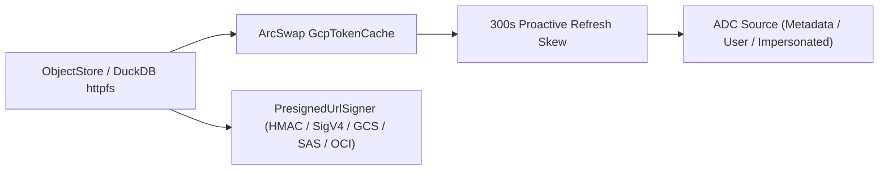

# GCS, Active ADC Credential Refresh & Presigning

Vertebra provides active Google Cloud Application Default Credentials (ADC) caching (`RefreshingGcpCredentialProvider`, `GcpTokenCache`) and multicloud URL/header presigning (`SigningConfig`, `PresignedUrlSigner`).



## Google Cloud Storage & Active ADC Refresh

When `service_account_path` and `service_account_key` are omitted on `GCSConfig`, Vertebra attaches `RefreshingGcpCredentialProvider` to `GoogleCloudStorageBuilder`. Tokens are cached in a wait-free `ArcSwapOption<GcpTokenSnapshot>` and refreshed `300s` before expiry under a single-flight `tokio::sync::Mutex` across `AuthorizedUser`, `MetadataServer`, `ImpersonatedServiceAccount`, and `Static` ADC sources:

```python
import os
from vertebra.storage import GCSConfig, ObjectStore

store = ObjectStore.from_config(GCSConfig(bucket="app-assets-production"))

sa_store = ObjectStore.from_config(
    GCSConfig(
        bucket="app-assets-production",
        service_account_path="/var/secrets/google/key.json",
    )
)

json_store = ObjectStore.from_config(
    GCSConfig(
        bucket="app-assets-production",
        service_account_key=os.environ["GCS_SERVICE_ACCOUNT_JSON"],
    )
)

signing_store = ObjectStore.from_config(
    GCSConfig(
        bucket="app-assets-production",
        service_account_email="backend@my-project.iam.gserviceaccount.com",
    )
)
```

- **Proactive Refresh & Generation Invalidation**: Expired or `401`-rejected tokens trigger `invalidate_if_generation(observed_gen)` so concurrent tasks coalesce into a single refresh call.
- **Keyless V4 Presigning**: Pass `service_account_email` to sign upload and download URLs via Google Cloud IAM's `signBlob` API without storing long-lived private keys in containers.

## Presigned URLs (`SigningConfig`)

Offload large client uploads and downloads directly to your storage origin using `SigningConfig` (`presign_get`, `presign_put`, `verify_presigned_url`), or compute Azure Blob SAS URLs (`SigningConfig.sign_azure_sas`) and OCI RSA-SHA256 request headers (`SigningConfig.sign_oci_headers`):

```python
from vertebra.storage import ObjectStore, SigningConfig

store = ObjectStore.from_memory(
    namespace="uploads",
    signing=SigningConfig(
        provider="hmac",
        hmac_secret="hmac-signing-key",
        endpoint="https://cdn.example.com",
    ),
)
download_url = store.presign_get("avatars/user-1.png", expires_in_secs=900)
upload_url = store.presign_put("avatars/user-1.png", expires_in_secs=300)
is_valid = store.verify_presigned_url(download_url, method="GET")
```
