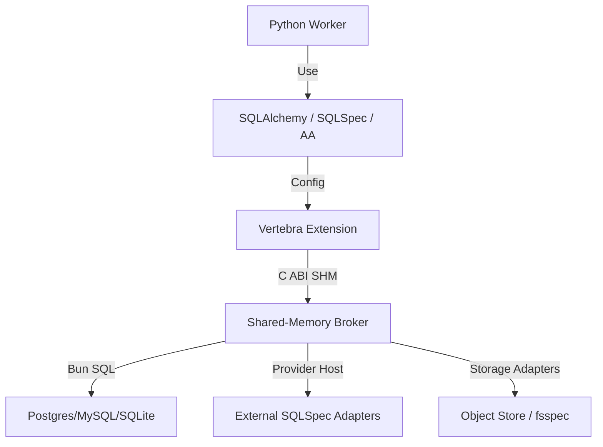

# PRD: Vertebra ORM Extensions (SQLSpec, SQLAlchemy & Advanced Alchemy)

## 1. Introduction

### 1.1 Purpose
To enable Python applications running on Vertebra to use industry-standard ORMs and query mappers (`sqlalchemy`, `advanced-alchemy`, `sqlspec`) while leveraging Vertebra's high-performance **shared-memory broker**. This allows users to write standard database code that transparently tunnels execution over zero-copy C ABI transport to a central connection pool manager.

### 1.2 Scope

This PRD covers four extension modules plus Litestar integration:

| Extension | Purpose | Location |
|-----------|---------|----------|
| **SQLSpec** | Broker-backed SQLSpec adapters with dialect-specific configs | `vertebra.extensions.sqlspec` |
| **SQLAlchemy** | Native SQLAlchemy drivers (`postgresql+vertebra://`, etc.) | `vertebra.extensions.sqlalchemy` |
| **Advanced Alchemy** | Broker-backed AA configs following SQLSpec pattern | `vertebra.extensions.advanced_alchemy` |
| **Serialization** | Extended type encoders/decoders for IPC and HTTP | `vertebra.extensions.serialization` |
| **Litestar Plugin** | Integration with Litestar's `SQLSpecPlugin` and `SQLAlchemyPlugin` | `vertebra.extensions.litestar` |

### 1.3 Key Architectural Principle

All three database extensions follow the same pattern:
1. **Client-side configs** use a broker proxy wrapper to route through shared memory
2. **Provider processes** run the original config and register with the broker
3. **Plugin registration** via `Vertebra(plugins=[...])` or `app.register_plugin(...)`

### 1.4 Naming Convention

All user-facing config classes use the `Vertebra` prefix for clarity:
- `VertebraPostgresAsyncConfig` (not `BrokerPostgresAsyncConfig`)
- `VertebraMysqlSyncConfig` (not `BrokerMysqlSyncConfig`)

This makes it explicit that these configs route through Vertebra's broker.

## 2. Architecture

### 2.1 Component Interaction


### 2.2 Extension Module: `vertebra.extensions.sqlspec` (Implemented - Rename Required)

Broker-backed SQLSpec adapters with dialect-specific configurations.

**Structure:**
```
vertebra/extensions/sqlspec/
├── __init__.py           # Import guards, exports
├── _config.py            # VertebraSyncConfigBase, VertebraAsyncConfigBase
├── _driver.py            # Base driver implementations
├── _shared.py            # Connection/pool wrappers, context managers
├── _core.py              # Profile and statement config builders
├── _dictionary.py        # Data dictionary resolvers
├── _serialization.py     # Serialization hooks (leverage SQLSpec utils)
├── _storage.py           # Storage backend integration (ObjectStoreBase)
├── proxy.py              # Proxy wrapper for client-side routing
├── provider.py           # Provider host for non-Bun adapters
├── postgres/
│   ├── __init__.py
│   ├── config.py         # VertebraPostgresSyncConfig, VertebraPostgresAsyncConfig
│   └── driver.py         # VertebraPostgresSyncDriver, VertebraPostgresAsyncDriver
├── mysql/
│   ├── __init__.py
│   ├── config.py         # VertebraMysqlSyncConfig, VertebraMysqlAsyncConfig
│   └── driver.py         # VertebraMysqlSyncDriver, VertebraMysqlAsyncDriver
└── sqlite/
    ├── __init__.py
    ├── config.py         # VertebraSqliteSyncConfig, VertebraSqliteAsyncConfig
    └── driver.py         # VertebraSqliteSyncDriver, VertebraSqliteAsyncDriver
```

**Usage:**
```python
from vertebra.extensions.sqlspec.postgres import VertebraPostgresAsyncConfig

config = VertebraPostgresAsyncConfig(pool="main")
async with config.provide_session() as session:
    result = await session.select("SELECT 1")
```

### 2.3 Extension Module: `vertebra.extensions.sqlalchemy` (New)

Native SQLAlchemy dialect drivers that route through the Vertebra broker.

**Dialects:**
- `postgresql+vertebra://pool_name` - PostgreSQL via Vertebra broker
- `mysql+vertebra://pool_name` - MySQL via Vertebra broker
- `sqlite+vertebra://pool_name` - SQLite via Vertebra broker

**Structure:**
```
vertebra/extensions/sqlalchemy/
├── __init__.py           # Dialect registration, exports
├── _dbapi.py             # PEP 249 DBAPI implementation (shared)
├── _base.py              # Base dialect classes (sync + async)
├── postgres/
│   ├── __init__.py
│   ├── dialect.py        # VertebraPostgresDialect, VertebraPostgresAsyncDialect
│   └── dbapi.py          # Postgres-specific DBAPI module
├── mysql/
│   ├── __init__.py
│   ├── dialect.py        # VertebraMysqlDialect, VertebraMysqlAsyncDialect
│   └── dbapi.py          # MySQL-specific DBAPI module
└── sqlite/
    ├── __init__.py
    ├── dialect.py        # VertebraSqliteDialect, VertebraSqliteAsyncDialect
    └── dbapi.py          # SQLite-specific DBAPI module
```

**Usage:**
```python
from sqlalchemy import create_engine
from sqlalchemy.ext.asyncio import create_async_engine

# Sync
engine = create_engine("postgresql+vertebra://main")

# Async
async_engine = create_async_engine("postgresql+vertebra://main")

async with async_engine.connect() as conn:
    result = await conn.execute(text("SELECT 1"))
```

**DBAPI Requirements:**
- Must implement PEP 249 (`connect`, `cursor`, `execute`, `fetchall`, `fetchone`, `fetchmany`)
- `paramstyle` mapped to underlying driver (`numeric` for Postgres, `qmark` for MySQL/SQLite)
- Transaction support (`begin`, `commit`, `rollback`) over IPC

### 2.4 Extension Module: `vertebra.extensions.advanced_alchemy` (New)

Broker-backed Advanced Alchemy configs following the same pattern as SQLSpec.

**Structure:**
```
vertebra/extensions/advanced_alchemy/
├── __init__.py           # Import guards, exports
├── _config.py            # VertebraSyncAlchemyConfig, VertebraAsyncAlchemyConfig base classes
├── _engine.py            # Engine factory using vertebra dialects
├── _storage.py           # StoredObject backend routing through broker
├── proxy.py              # Proxy wrapper for client-side routing
├── provider.py           # Provider host for custom AA configs
├── postgres/
│   ├── __init__.py
│   └── config.py         # VertebraPostgresAlchemySyncConfig, VertebraPostgresAlchemyAsyncConfig
├── mysql/
│   ├── __init__.py
│   └── config.py         # VertebraMysqlAlchemySyncConfig, VertebraMysqlAlchemyAsyncConfig
└── sqlite/
    ├── __init__.py
    └── config.py         # VertebraSqliteAlchemySyncConfig, VertebraSqliteAlchemyAsyncConfig
```

**Usage:**
```python
from vertebra.extensions.advanced_alchemy.postgres import VertebraPostgresAlchemyAsyncConfig
from advanced_alchemy.service import SQLAlchemyAsyncRepositoryService

config = VertebraPostgresAlchemyAsyncConfig(pool="main")

class UserService(SQLAlchemyAsyncRepositoryService[User]):
    # Works unchanged - config handles broker routing
    pass
```

**Key Features:**
- Repository and Service patterns work unchanged
- File Object Storage routes through broker storage pipeline
- Alembic migrations supported via broker connection

### 2.5 Extension Module: `vertebra.extensions.serialization` (New)

Extended type encoders/decoders that work across IPC transport and HTTP responses.

**Motivation:**

SQLSpec provides a multi-tier serialization system (msgspec > orjson > stdlib) with type hooks for datetime, Decimal, enums, numpy, Pydantic models, and Arrow. Litestar provides `type_encoders`/`type_decoders` for Path, IP addresses, datetime, collections, Pattern, SecretBytes/SecretString.

Vertebra needs to extend both systems to handle:
1. **IPC-specific types**: SharedMemoryHandle, RingBufferRef, ArrowBatch references
2. **Database result types**: Database-native types (Postgres arrays, JSONB, MySQL spatial, etc.)
3. **Storage types**: FileObject, StoredObject references
4. **Unified encoding**: Single codec that works for both IPC (MessagePack) and HTTP (JSON)

**Structure:**
```
vertebra/extensions/serialization/
├── __init__.py           # Unified exports
├── _types.py             # Vertebra-specific type definitions
├── _encoders.py          # Type encoder hooks
├── _decoders.py          # Type decoder hooks
├── msgpack.py            # MessagePack codec with Vertebra types
├── json.py               # JSON codec with Vertebra types
└── litestar.py           # Litestar type_encoders/type_decoders integration
```

**Type Support Matrix:**

| Type | JSON Encode | JSON Decode | MessagePack | Notes |
|------|-------------|-------------|-------------|-------|
| `datetime` | ISO 8601 | Parse ISO | Native | SQLSpec pattern |
| `date` | ISO format | Parse ISO | String | |
| `time` | ISO format | Parse ISO | String | |
| `timedelta` | Seconds float | From seconds | Float | |
| `Decimal` | String | From string | String | Preserve precision |
| `UUID` | String | From string | Bytes | |
| `Path`/`PurePath` | String | From string | String | Litestar pattern |
| `IPv4Address`/`IPv6Address` | String | From string | String | Litestar pattern |
| `IPv4Network`/`IPv6Network` | String | From string | String | |
| `Pattern` | `.pattern` | `re.compile` | String | |
| `Enum` | `.value` | From value | Value | |
| `set`/`frozenset` | List | From list | List | |
| `deque` | List | From list | List | |
| `bytes` | Base64 | From base64 | Native | |
| `SecretStr`/`SecretBytes` | Masked | N/A | Masked | Security |
| **Pydantic BaseModel** | `.model_dump()` | `.model_validate()` | Dict | |
| **msgspec.Struct** | Dict | From dict | Dict | |
| **dataclass** | `asdict()` | From dict | Dict | |
| **attrs** | `asdict()` | From dict | Dict | |
| **numpy.ndarray** | List | `np.array()` | List | Optional |
| **Arrow Table** | IPC bytes | From IPC | IPC bytes | Large results |
| **FileObject** | Metadata dict | From metadata | Dict | Storage ref |
| **Postgres JSONB** | Pass-through | Pass-through | Dict | |
| **Postgres Array** | List | List | List | |

**Usage with Litestar:**
```python
from litestar import Litestar
from vertebra.extensions.serialization.litestar import (
    VERTEBRA_TYPE_ENCODERS,
    VERTEBRA_TYPE_DECODERS,
)

app = Litestar(
    routes=[...],
    type_encoders=VERTEBRA_TYPE_ENCODERS,
    type_decoders=VERTEBRA_TYPE_DECODERS,
)
```

**Usage with IPC:**
```python
from vertebra.extensions.serialization.msgpack import VertebraCodec

codec = VertebraCodec()
encoded = codec.encode({"created_at": datetime.now(), "amount": Decimal("19.99")})
decoded = codec.decode(encoded, type_hint=MyModel)
```

### 2.6 Extension Module: `vertebra.extensions.litestar` (Overhaul Required)

Integration with Litestar's plugin ecosystem. This is more complex because Litestar has separate plugins for SQLSpec and SQLAlchemy.

**Current State:** Simple plugin in `litestar.py`

**Required Structure:**
```
vertebra/extensions/litestar/
├── __init__.py           # Main VertebraPlugin, exports
├── _base.py              # Base plugin infrastructure
├── _serialization.py     # Auto-register Vertebra type encoders/decoders
├── sqlspec.py            # Integration with Litestar's SQLSpecPlugin
├── sqlalchemy.py         # Integration with Litestar's SQLAlchemyPlugin
└── advanced_alchemy.py   # Integration with AA's Litestar plugin
```

**Integration Points:**

1. **SQLSpec Plugin Integration:**
```python
from litestar import Litestar
from vertebra.extensions.litestar import VertebraSQLSpecPlugin
from vertebra.extensions.sqlspec.postgres import VertebraPostgresAsyncConfig

app = Litestar(
    plugins=[
        VertebraSQLSpecPlugin(
            config=VertebraPostgresAsyncConfig(pool="main"),
        ),
    ]
)
```

2. **SQLAlchemy Plugin Integration:**
```python
from litestar import Litestar
from vertebra.extensions.litestar import VertebraSQLAlchemyPlugin

app = Litestar(
    plugins=[
        VertebraSQLAlchemyPlugin(
            connection_string="postgresql+vertebra://main",
        ),
    ]
)
```

3. **Advanced Alchemy Plugin Integration:**
```python
from litestar import Litestar
from vertebra.extensions.litestar import VertebraAdvancedAlchemyPlugin
from vertebra.extensions.advanced_alchemy.postgres import VertebraPostgresAlchemyAsyncConfig

app = Litestar(
    plugins=[
        VertebraAdvancedAlchemyPlugin(
            config=VertebraPostgresAlchemyAsyncConfig(pool="main"),
        ),
    ]
)
```

**Serialization Auto-Registration:**

All Vertebra Litestar plugins automatically register `VERTEBRA_TYPE_ENCODERS` and `VERTEBRA_TYPE_DECODERS` so that route handlers can return Vertebra-specific types (FileObject, database arrays, etc.) without manual configuration.

### 2.7 Storage Module Integration

Both Advanced Alchemy and SQLSpec have storage abstractions that must route through Vertebra's broker.

#### 2.7.1 Advanced Alchemy StoredObject

AA's `StoredObject` type uses `FSSpecBackend` or `OBStoreBackend` for file storage. Vertebra provides a `VertebraStorageBackend` that routes operations through the broker.

**Integration:**
```python
from advanced_alchemy.types.file_object import storages
from vertebra.extensions.advanced_alchemy import VertebraStorageBackend

# Register Vertebra backend
storages.register_backend(VertebraStorageBackend(pool="storage", key="vertebra"))

# Use in models
class Document(UUIDBase):
    attachment: Mapped[FileObject | None] = mapped_column(
        StoredObject(backend="vertebra"), nullable=True
    )
```

**Backend Implementation:**
```python
class VertebraStorageBackend:
    """Routes AA StoredObject operations through Vertebra broker."""

    def __init__(self, pool: str = "storage", key: str = "vertebra"):
        self.pool = pool
        self.key = key

    async def read_bytes(self, path: str) -> bytes:
        # Route through broker's storage pool
        return await broker.storage_read(self.pool, path)

    async def write_bytes(self, path: str, data: bytes) -> None:
        await broker.storage_write(self.pool, path, data)

    # ... other methods: list_objects, exists, delete, copy, move, glob
```

#### 2.7.2 SQLSpec ObjectStoreBase

SQLSpec defines an `ObjectStoreBase` protocol with similar operations. Vertebra provides a compatible implementation.

**Integration:**
```python
from vertebra.extensions.sqlspec import VertebraObjectStore

store = VertebraObjectStore(pool="storage")

# Use with SQLSpec storage features
async with store.open("path/to/file.csv") as f:
    content = await f.read()
```

**Protocol Alignment:**

| AA Backend Method | SQLSpec ObjectStore Method | Vertebra Implementation |
|-------------------|---------------------------|------------------------|
| `read_bytes()` | `read_bytes()` | `broker.storage_read()` |
| `write_bytes()` | `write_bytes()` | `broker.storage_write()` |
| `stream_read()` | `stream_read()` | `broker.storage_stream()` |
| `list_objects()` | `list_objects()` | `broker.storage_list()` |
| `exists()` | `exists()` | `broker.storage_exists()` |
| `delete()` | `delete()` | `broker.storage_delete()` |
| `copy()` | `copy()` | `broker.storage_copy()` |
| `move()` | `move()` | `broker.storage_move()` |
| `glob()` | `glob()` | `broker.storage_glob()` |

## 3. Detailed Requirements

### 3.1 SQLSpec Extension (Implemented - Rename + Storage Required)
- [x] Requirement 3.1.1: Broker-backed drivers in `vertebra.extensions.sqlspec`
- [x] Requirement 3.1.2: Dialect-specific configs (Postgres, MySQL, SQLite)
- [x] Requirement 3.1.3: `dispatch_execute` and `dispatch_execute_many` (sync + async)
- [ ] Requirement 3.1.4: Native Arrow result transport for large results
- [ ] Requirement 3.1.5: Storage operations through `VertebraObjectStore`
- [ ] Requirement 3.1.6: **Rename `Broker*` to `Vertebra*` in all public APIs**

### 3.2 SQLAlchemy Extension (New)
- [ ] Requirement 3.2.1: PEP 249 DBAPI module in `vertebra.extensions.sqlalchemy._dbapi`
- [ ] Requirement 3.2.2: Dialect classes for Postgres, MySQL, SQLite (sync + async)
- [ ] Requirement 3.2.3: Dialect registration so `create_engine("postgresql+vertebra://")` works
- [ ] Requirement 3.2.4: Transaction support (`begin`/`commit`/`rollback`) over IPC
- [ ] Requirement 3.2.5: Type compilation for common SQLAlchemy types

### 3.3 Advanced Alchemy Extension (New)
- [ ] Requirement 3.3.1: Base config classes mirroring SQLSpec pattern
- [ ] Requirement 3.3.2: Dialect-specific configs (Postgres, MySQL, SQLite)
- [ ] Requirement 3.3.3: Repository/Service patterns work unchanged
- [ ] Requirement 3.3.4: `VertebraStorageBackend` for File Object Storage
- [ ] Requirement 3.3.5: Alembic migration support

### 3.4 Serialization Extension (New)
- [ ] Requirement 3.4.1: `VertebraCodec` for MessagePack with extended type support
- [ ] Requirement 3.4.2: JSON encoder/decoder hooks matching SQLSpec's pattern
- [ ] Requirement 3.4.3: `VERTEBRA_TYPE_ENCODERS` dict for Litestar integration
- [ ] Requirement 3.4.4: `VERTEBRA_TYPE_DECODERS` list for Litestar integration
- [ ] Requirement 3.4.5: Leverage SQLSpec's serializer fallback chain (msgspec > orjson > stdlib)
- [ ] Requirement 3.4.6: Support for database-specific types (Postgres arrays, JSONB)

### 3.5 Litestar Plugin Overhaul (New)
- [ ] Requirement 3.5.1: `VertebraSQLSpecPlugin` wrapping Litestar's SQLSpecPlugin
- [ ] Requirement 3.5.2: `VertebraSQLAlchemyPlugin` wrapping `litestar.contrib.sqlalchemy.SQLAlchemyPlugin`
- [ ] Requirement 3.5.3: `VertebraAdvancedAlchemyPlugin` wrapping `advanced_alchemy.extensions.litestar.SQLAlchemyPlugin`
- [ ] Requirement 3.5.4: Unified `VertebraPlugin` that can register all three based on config
- [ ] Requirement 3.5.5: Auto-register `VERTEBRA_TYPE_ENCODERS`/`VERTEBRA_TYPE_DECODERS`

### 3.6 Configuration & Extension API
- [ ] Requirement 3.6.1: Plugin registration via `Vertebra(plugins=[...])` / `register_plugin(...)`
- [ ] Requirement 3.6.2: Extensions hook into worker startup to initialize shared-memory transport
- [ ] Requirement 3.6.3: Provider registration for non-Bun SQLSpec adapters

## 4. Acceptance Criteria

### 4.1 SQLSpec (Verify + Rename)
- [ ] User can create a SQLSpec Vertebra config and execute queries via shared memory
- [ ] `await session.select("SELECT 1")` works
- [ ] Transactions work correctly
- [ ] **All public APIs use `Vertebra*` prefix**

### 4.2 SQLAlchemy
- [ ] `create_engine("postgresql+vertebra://main")` works
- [ ] `create_async_engine("postgresql+vertebra://main")` works
- [ ] `engine.connect()` establishes a virtual connection
- [ ] `await conn.execute(text("SELECT 1"))` returns `1`
- [ ] Transactions: `async with engine.begin(): ...` commits on exit, rolls back on error

### 4.3 Advanced Alchemy
- [ ] `VertebraPostgresAlchemyAsyncConfig` works with AA's Repository pattern
- [ ] `VertebraPostgresAlchemyAsyncConfig` works with AA's Service pattern
- [ ] File Object Storage operations route through `VertebraStorageBackend`
- [ ] Alembic migrations work via broker connection

### 4.4 Serialization
- [ ] `VertebraCodec.encode()` handles all types in the support matrix
- [ ] `VertebraCodec.decode()` reconstructs typed objects
- [ ] Litestar apps with Vertebra plugins can return `FileObject` from route handlers
- [ ] Database-specific types (Postgres arrays, JSONB) serialize correctly

### 4.5 Litestar Integration
- [ ] `VertebraSQLSpecPlugin` works with Litestar app
- [ ] `VertebraSQLAlchemyPlugin` works with Litestar app
- [ ] `VertebraAdvancedAlchemyPlugin` works with Litestar app
- [ ] DI correctly provides sessions/connections to route handlers
- [ ] Type encoders/decoders auto-registered

### 4.6 Performance
- [ ] Result transport overhead for small queries (< 100 rows) < 1ms added latency
- [ ] Large result sets (> 10k rows) utilize Arrow serialization

## 5. Implementation Order

1. **Phase 1: Rename + Serialization Foundation**
   - Rename all `Broker*` to `Vertebra*` in existing SQLSpec extension
   - Implement `vertebra.extensions.serialization` module
   - Add `VertebraCodec` with full type support matrix

2. **Phase 2: SQLAlchemy Dialects**
   - Implement DBAPI and dialect classes
   - Register dialects for `postgresql+vertebra://`, etc.

3. **Phase 3: Storage Integration**
   - Implement `VertebraStorageBackend` for AA
   - Implement `VertebraObjectStore` for SQLSpec
   - Wire into broker's storage pool

4. **Phase 4: Advanced Alchemy**
   - Implement broker-backed configs
   - Integrate storage backend

5. **Phase 5: Litestar Overhaul**
   - Implement all three plugin wrappers
   - Auto-register serialization hooks

6. **Phase 6: Integration Testing**
   - Full end-to-end tests with real databases
   - Test with mypyc-compiled SQLSpec

## 6. Dependencies

- `sqlspec` >= latest stable (pure Python or mypyc-compiled)
- `advanced-alchemy` >= latest stable
- `sqlalchemy` >= 2.0
- `litestar` >= 2.0 (includes SQLSpec and SQLAlchemy plugin support)
- `msgspec` >= 0.18 (optional, for high-performance serialization)
- `orjson` >= 3.9 (optional, fallback serializer)

## 7. Mypyc Compatibility

SQLSpec offers a mypyc-compiled variant for improved performance. Our Rust bridge interaction:

### 7.1 Why It Works
- **Layer separation**: Rust FFI operates at the IPC/shared-memory layer, below SQLSpec's execution path
- **No monkey-patching**: We subclass configs, not modify SQLSpec internals
- **CFFI compatibility**: Both mypyc and CFFI produce C extensions that coexist without conflict

### 7.2 Considerations
- **Proxy pattern risk**: Mypyc-compiled code may reject dynamic `__getattr__` forwarding. Our `proxy.py` must use explicit delegation, not magic methods.
- **Type strictness**: Mypyc enforces type annotations at runtime. Our config classes must have complete, accurate type hints.
- **Testing matrix**: CI must test with both pure Python and mypyc-compiled SQLSpec.

### 7.3 Implementation Guidance
```python
# BAD - mypyc may reject dynamic forwarding
class VertebraProxy:
    def __getattr__(self, name):
        return getattr(self._wrapped, name)

# GOOD - explicit delegation works with mypyc
class VertebraPostgresAsyncConfig(PostgresAsyncConfig):
    def provide_session(self) -> AsyncContextManager[AsyncSession]:
        # Explicit override, delegates to broker
        return self._broker_session_factory()
```

### 7.4 Acceptance Criteria
- [ ] All extension code passes `mypy --strict`
- [ ] Tests pass with mypyc-compiled SQLSpec
- [ ] Tests pass with pure Python SQLSpec
- [ ] No `__getattr__` or `__getattribute__` overrides in production code

## 8. Future Work

- Server-side cursors (streaming results)
- Specialized dialect features (Postgres arrays, JSONB) via type bridging
- Support for additional databases (DuckDB, Oracle, BigQuery) via provider pattern
- NumPy/Pandas integration for data science workflows
- GraphQL type mapping

## 9. References

- [Litestar Custom Types](https://docs.litestar.dev/2/usage/custom-types.html)
- [Litestar Serialization Reference](https://docs.litestar.dev/latest/reference/serialization.html)
- [Advanced Alchemy File Storage](https://docs.advanced-alchemy.litestar.dev/latest/usage/types.html)
- [msgspec Performance](https://jcristharif.com/msgspec/)
